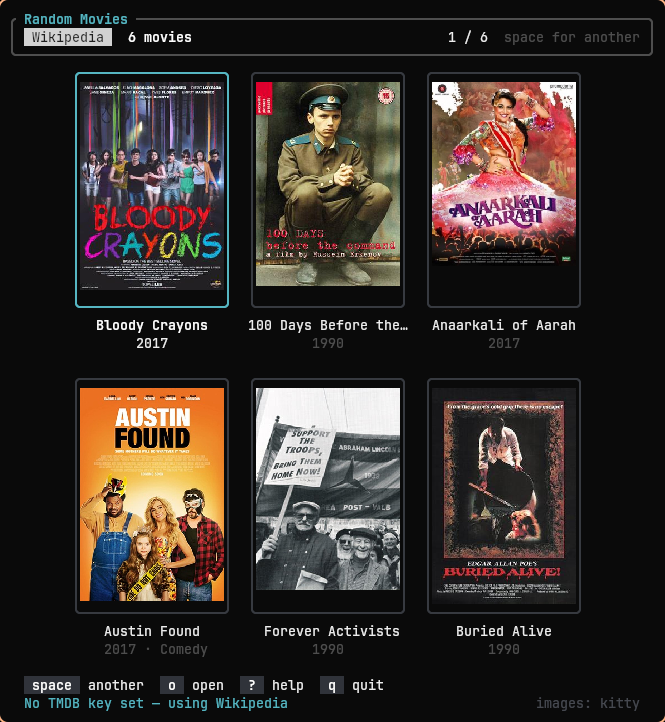
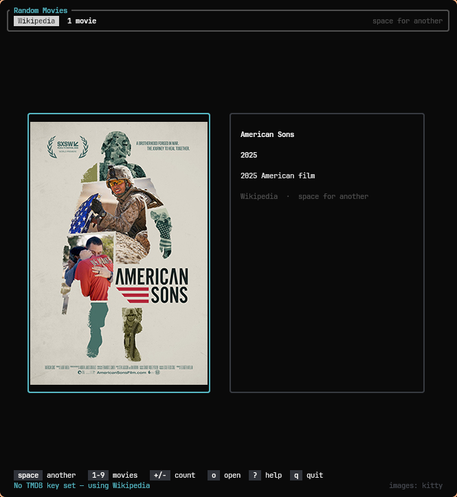
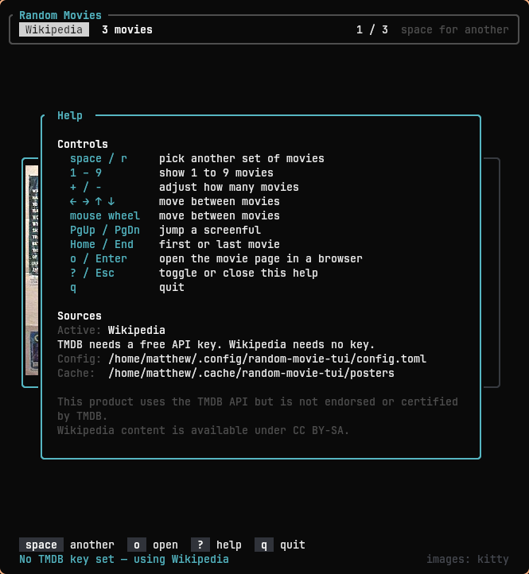

# Random Movie TUI

A small terminal UI that picks random movies and shows their posters, inspired by
[randommer.io](https://randommer.io/random-movies). Built with Rust, [ratatui](https://ratatui.rs),
and [ratatui-image](https://github.com/ratatui/ratatui-image).

## Screenshots

<p align="center">
  
  
</p>
<p align="center">
  
</p>

## Features

- Random movies with poster images, right in the terminal
- Quick refresh (`space` or `r`)
- Choose 1 to 20 movies with `--count`, number keys, or `+` / `-`
- TMDB data when an API key is available, Wikipedia as a keyless fallback
- Kitty, Sixel, and iTerm2 graphics when supported, with a universal
  Unicode half-block fallback
- Poster cache, so repeat picks load instantly
- Responsive layout that scrolls for larger sets

## Requirements

- Rust 1.88 or newer
- A terminal with truecolor support, at least 46 × 16 cells
- Optional but recommended: a terminal with an image protocol (Kitty, WezTerm,
  Ghostty, foot, iTerm2, or a Sixel-capable terminal). Without one, the app
  draws posters with half blocks. You can force this with `--halfblocks`.

`libchafa` is **not** required.

## Install and run

```sh
git clone git@github.com:Kungger-git/random-movie-tui.git
cd random-movie-tui
cargo run --release
```

Or install the binary:

```sh
cargo install --path .
random-movie-tui
```

The app starts with one random movie and no TMDB key, using Wikipedia
automatically.

## Usage

```sh
random-movie-tui                     # one movie, TMDB if configured, else Wikipedia
random-movie-tui --count 6           # a 6-poster grid
random-movie-tui --source wikipedia  # force the keyless source
random-movie-tui --source tmdb       # require TMDB
random-movie-tui --halfblocks        # force Unicode half-block posters
random-movie-tui --api-key KEY       # use a key for this run
```

Number keys and `+` / `-` change the count while the app is running. Changing
the count immediately fetches a new set.

## Controls

| Key | Action |
| --- | --- |
| `space` / `r` | Pick another set of movies |
| `1` – `9` | Show 1 to 9 movies |
| `+` / `-` | Increase or decrease the count (up to 20) |
| `←` `→` `↑` `↓` / `hjkl` | Move between movies |
| Mouse wheel | Move between movies |
| `PgUp` / `PgDn` | Jump a screenful |
| `Home` / `End` / `g` / `G` | First or last movie |
| `o` / `Enter` | Open the selected movie page in a browser |
| `?` | Toggle help |
| `q` / `Esc` / `Ctrl+C` | Quit |

Mouse scrolling works in terminals that report mouse events to the app.

## TMDB setup

TMDB is optional. The app falls back to Wikipedia when no key is configured.

1. Create a free [TMDB account](https://www.themoviedb.org/signup).
2. Request an API key under **Settings → API**.
3. Provide it in one of these ways, highest precedence first:

```sh
# 1. Command line
random-movie-tui --api-key YOUR_KEY

# 2. Environment
export TMDB_API_KEY=YOUR_KEY
# or a v4 read access token:
export TMDB_READ_ACCESS_TOKEN=YOUR_TOKEN
```

```toml
# 3. ~/.config/random-movie-tui/config.toml
tmdb_api_key = "YOUR_KEY"
# or:
tmdb_read_access_token = "YOUR_TOKEN"
```

A v4 read access token starts with `eyJ` and can also be passed to `--api-key`.

Precedence is: `--api-key`, `TMDB_API_KEY`, `TMDB_READ_ACCESS_TOKEN`, then the
config file. If TMDB is unavailable in `--source auto`, the app shows a warning
and uses Wikipedia for that fetch.

## Cache

Posters are cached in:

```
~/.cache/random-movie-tui/posters/
```

Delete that directory to reclaim space or force fresh downloads.

## Data and attribution

- Movie data and posters from [TMDB](https://www.themoviedb.org/).
  This product uses the TMDB API but is not endorsed or certified by TMDB.
- Fallback data and images from Wikipedia / Wikimedia Commons. Wikipedia
  content is available under
  [CC BY-SA](https://creativecommons.org/licenses/by-sa/4.0/); images keep their
  individual licenses.

## Development

```sh
cargo fmt
cargo test
cargo clippy --all-targets
```

Live source tests are ignored by default because they need network access:

```sh
cargo test live_fetch_returns_movies_with_posters -- --ignored
```

## License

MIT
